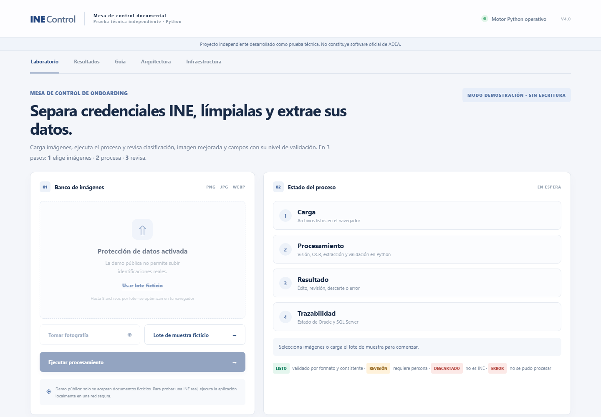
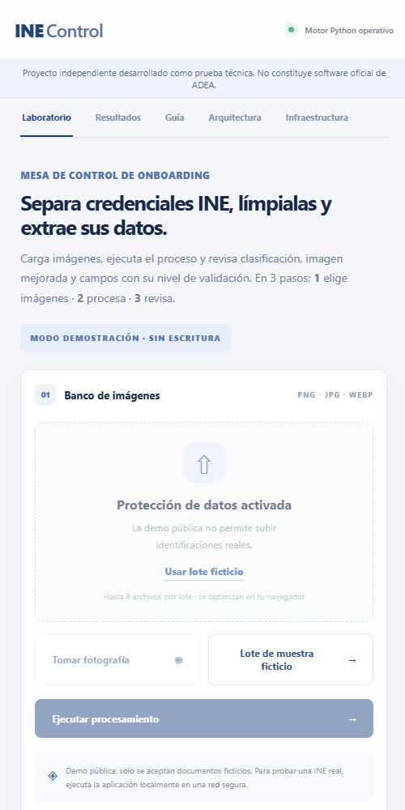

# INE Control · Mesa de control documental en Python (V4.0)

> **Proyecto independiente desarrollado como prueba técnica. No constituye software oficial de ADEA.**

Demo pública (solo documentos ficticios): **https://adea-ine-control.vercel.app**

| Escritorio | Móvil |
|---|---|
|  |  |

## 1. Presentación
INE Control recibe un lote heterogéneo de imágenes, separa las credenciales INE/IFE, mejora la imagen, extrae sus campos, los valida y registra el expediente en **Oracle** (`SP_REGISTRAR_EXPEDIENTE`) con auditoría en **SQL Server**. Todo el procesamiento está en Python; la interfaz web solo presenta resultados.

## 2. Problema planteado
Una mesa de control de onboarding recibe carpetas mezcladas (INE, licencias, contratos, escrituras, fotos con ruido). El examen pide un proceso batch en Python que separe de forma autónoma las credenciales INE, aplique limpieza visual, extraiga datos estructurados y los persista en Oracle y SQL Server.

## 3. Objetivos del examen y cómo se cubren
| Requisito | Implementación | Evidencia |
|---|---|---|
| Separar solo INE | Clasificador híbrido de reglas (`app/classification.py`) | Pruebas negativas, incluido un contrato con CURP válida |
| Limpieza visual | OpenCV: contornos, perspectiva, CLAHE, denoise, binarización (`app/imaging.py`) | `tests/test_ocr_real.py` |
| CURP / clave de elector (regex del examen) | `app/validation.py` + dígito verificador, fecha y entidad | `tests/test_validation.py` |
| Nombre, domicilio, datos electorales | `app/extraction.py` | `tests/test_pipeline.py` |
| MRZ 3 líneas, QR, PDF417 | MRZ TD1 con dígitos verificadores; ZXing-cpp | `tests/test_ocr_real.py` |
| Oracle `SP_REGISTRAR_EXPEDIENTE` + SQL Server | `app/persistence.py` (python-oracledb, pyodbc) | `tests/test_integration_real.py` (bases reales locales) |

## 4. Arquitectura
```
Navegador / PWA ──JSON──▶ FastAPI (app/main.py)
                            ├─ imaging (OpenCV) ─▶ ocr (Tesseract | RapidOCR) ─▶ extraction ─▶ validation
                            ├─ classification · pairing (frente/reverso)
                            └─ persistence ─▶ Oracle (SP) · SQL Server (auditoría sin datos personales)
```
Módulos y decisiones: [ARQUITECTURA.md](ARQUITECTURA.md) · [docs/V4_TECHNICAL_HANDOFF.md](docs/V4_TECHNICAL_HANDOFF.md).

## 5. Tecnologías
Python 3.12+, FastAPI, Uvicorn, OpenCV, NumPy, Pillow, Tesseract 5 (local), RapidOCR/ONNX Runtime (nube), ZXing-cpp, python-oracledb, pyodbc, HTML/CSS/JS sin framework, PWA, GitHub Actions, Vercel.

## 6. Flujo de clasificación
Señales **fuertes** (emisor INE/IFE, leyenda «Credencial para votar», MRZ con emisor MEX, código que referencia al INE), **estructurales** (≥3 etiquetas electorales, CURP/clave con formato, dígitos MRZ, códigos, contorno ID‑1, bloque de foto) y **negativas** (leyendas de contrato, acta, escritura, licencia). INE = ≥1 fuerte + ≥2 estructurales sin negativas; evidencia parcial = revisión. No es un modelo entrenado y una CURP sola nunca basta.

## 7. Procesamiento visual
Canny → contornos → cuadrilátero con proporción ID‑1 → `warpPerspective`. Se comparan varias estrategias (original, contraste CLAHE, denoise, binarización adaptativa) y se elige la de mejor lectura medida (confianza OCR × palabras). Si no hay tarjeta localizable, se informa: nunca se simula una corrección.

## 8. Extracción OCR
- **Local (Windows):** Tesseract 5 (`spa+eng`).
- **Nube (Vercel):** RapidOCR (modelos PP‑OCR en ONNX, vendorizado en `vendor/`, Apache‑2.0) porque Vercel no permite instalar binarios del sistema. **Verificado en producción** con las muestras ficticias.
- Las correcciones de caracteres (O→0, I→1…) se registran aparte y dejan el campo «pendiente de confirmación».

## 9. Validación de campos
Estados: `DETECTADO`, `VALIDADO_POR_FORMATO`, `PENDIENTE_CONFIRMACION`, `NO_DETECTADO`, `INVALIDO`. Validación cruzada CURP ↔ clave de elector ↔ MRZ. Un formato correcto **no** prueba autenticidad.

## 10. Oracle y SQL Server
- Oracle AI Database Free (imagen oficial en Docker) y SQL Server 2025 LocalDB **instalados y probados en la PC de desarrollo** (6/6 pruebas reales: registro, auditoría, lote, fallos controlados, reinicio).
- Sin credenciales, la app muestra **NO CONFIGURADO** y no simula escrituras. «Conectado y validado» solo tras una consulta real.
- La demo pública **no** se conecta a esas bases (no se exponen a Internet).

## 11. Experiencia móvil
Diseño responsive real (verificado por emulación a 390, 430, 768 y 1440 px), botones grandes, cámara con marco ID‑1 e indicador de luz/nitidez, emparejamiento por **QR** con HTTPS local (puerto 8443) para usar la cámara del teléfono en la red privada.

## 12. PWA
Manifiesto + service worker (solo cachea el armazón estático; nunca respuestas de `/api`). Registro del service worker verificado en la URL de Vercel.

## 13. Seguridad
Repositorio sin secretos ni imágenes reales (auditado antes de cada push; `tests/test_security.py`), credenciales solo en `.env.local` (ignorado), SQL parametrizado, CSP estricta, escape de todo valor OCR, demo pública sin cargas reales (`403`), emparejamiento solo local y con token.

## 14. Instalación local (Windows)
```powershell
winget install UB-Mannheim.TesseractOCR
git clone https://github.com/lilpne25-ui/ADEA-Prueba-.git
cd ADEA-Prueba-
.\INICIAR_WINDOWS.bat
```
Bases locales opcionales: [DEPLOYMENT_GUIDE.md §1b](DEPLOYMENT_GUIDE.md).

## 15. Pruebas
`pytest -q` → 81 exitosas, 6 omitidas (integración con bases reales, se activan con `ADEA_REAL_DB=1`). CI en GitHub Actions ejecuta la suite con Tesseract y valida el motor RapidOCR. Detalle: [TEST_REPORT.md](TEST_REPORT.md).

## 16. Limitaciones reales
- Precisión con INE reales **no medida** (solo muestras sintéticas); en una prueba local con una credencial real se leyeron CURP y clave, pero no nombre, sección ni MRZ.
- RapidOCR en la nube tarda ~5–10 s por imagen.
- En Linux (CI y Vercel) el MRZ de la muestra sintética no se reconoce porque se dibuja con la fuente monoespaciada del sistema (Tesseract/RapidOCR confunden `<`); por eso en la demo pública el reverso ficticio queda descartado. En Windows sí se reconoce.
- Cámara en vivo no probada en un teléfono físico.
- Firma real de `SP_REGISTRAR_EXPEDIENTE` desconocida (contrato de demostración configurable).

## 17. Enlaces
- Demo: https://adea-ine-control.vercel.app
- Manuales: [usuario](MANUAL_USUARIO.md) · [técnico](MANUAL_TECNICO.md) · [despliegue](DEPLOYMENT_GUIDE.md)

## 18. Capturas
Las capturas de arriba usan exclusivamente la interfaz pública sin documentos reales.
