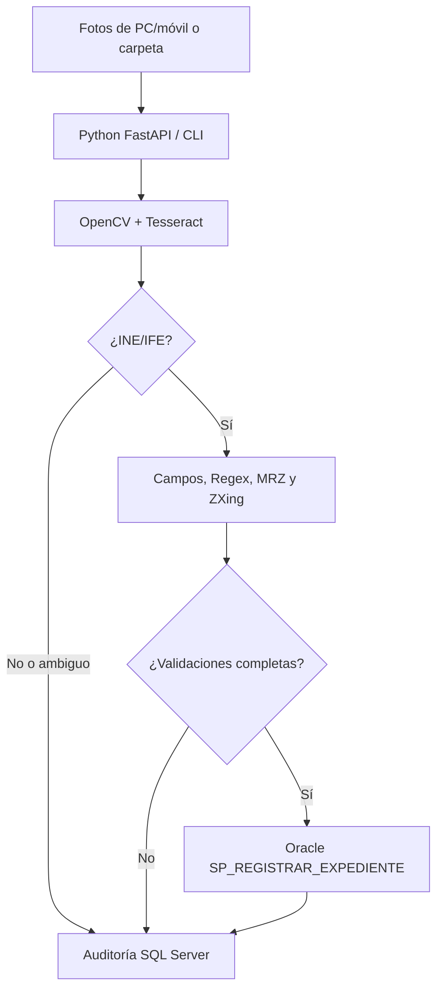

# Manual técnico — ADEA INE Control

**Revisión:** 1.0 · **Lenguaje central:** Python 3.12 · **UI:** HTML/CSS/JS sin framework · **API:** FastAPI.

## 1. Matriz exacta contra el examen

| Requisito PDF | Implementación | Nivel de evidencia |
|---|---|---|
| Banco de imágenes heterogéneo | Web: selección múltiple (máx. 8 por lote). CLI: recorrido de carpeta. | Implementado |
| Clasificación INE/IFE vs. otros | Evidencias OCR, CURP/clave con Regex y MRZ; clase `ine/revision/descartado`. | Heurística funcional, no ML entrenado |
| Descarte + SQL Server Audit Log | `sqlserver_audit()` para descartes, revisiones y registros. | Código implementado; requiere BD y credenciales |
| Warp Perspective | OpenCV: Canny → contornos → polígono de 4 vértices → homografía y warp. | Funciona si hay 4 esquinas detectables y OpenCV está instalado |
| Binarización adaptativa | `cv2.adaptiveThreshold` o umbral local por imagen integral con NumPy. | Implementado |
| Extracción CURP | Regex estricta del PDF: `^[A-Z]{4}\d{6}[HM][A-Z]{5}[0-9A-Z]\d$`. | Implementado con búsqueda de límites alfanuméricos |
| Extracción clave elector | Regex estricta del PDF: `^[A-Z]{6}\d{8}[HM]\d{3}$`. | Implementado con búsqueda de límites alfanuméricos |
| Nombres/apellidos | Línea(s) posteriores a etiqueta `NOMBRE`. | Heurístico; revisión humana |
| Domicilio | Texto completo bajo `DOMICILIO`; código postal y municipio/colonia cuando hay etiquetas legibles. | Parcial, no se adivinan subcampos |
| Estado, sección, municipio, localidad | OCR y extracción por etiqueta. | Implementado, dependiente de legibilidad |
| Año registro, emisión y vigencia | OCR y extracción por etiqueta. | Implementado, dependiente de legibilidad |
| MRZ tres líneas reverso | OCR global y región inferior; evaluación de 3 líneas alfanuméricas con `<`. | Estructura implementada; sin checksums oficiales |
| QR/PDF417 reverso | ZXing C++ por imagen. | Implementado si está instalado; algunos diseños no son decodificables |
| Oracle `SP_REGISTRAR_EXPEDIENTE` | `oracledb.connect` + `cursor.callproc`, con contrato ejemplo de 17 argumentos. | Código implementado; contrato real no entregado |
| SQL Server Log | `pyodbc` parametrizado, esquema en `sql/sqlserver_audit.sql`. | Código implementado; prueba real pendiente |

## 2. Arquitectura

En modo demo, las flechas de BD se sustituyen por el estado explícito `demo_sin_persistencia`, **sin escrituras simuladas que parezcan reales**.

## 3. Componentes

- `app/pipeline.py`: lectura de imagen, perspectiva, binarización, Tesseract, ZXing, parseo y decisión.
- `app/persistence.py`: separación de adaptadores corporativos y demo.
- `app/main.py`: API, servicio de interfaz, política de carga y cabeceras de seguridad.
- `app/batch.py`: procesamiento de un directorio heterogéneo sin límite de ocho archivos.
- `public/`: interfaz responsive y tutorial integrado.
- `sql/`: DDL demostrativo para ambientes de prueba.

## 4. Estados y persistencia

1. `listo`: evidencias de INE + CURP/clave electoral cumplen ambas regex; se llama a Oracle en modo corporativo.
2. `revision`: OCR ambiguo/incompleto; **no** se registra una identidad no corroborada en Oracle.
3. `descartado`: no se reconoce INE; solo evento de auditoría.
4. `error`: fallo de archivo/OCR; requiere corrección operativa.

La tabla SQL registra **hash SHA-256 del archivo, nombre, clasificación, estatus, resultado, flags de formato, tiempo y fecha UTC**; no copia el OCR ni CURP. Oracle usa `FILE_SHA256` único en el esquema demo para idempotencia básica.

La integración entre Oracle y SQL Server **no es una transacción distribuida**. Si Oracle registra, pero SQL Server falla, la respuesta indica `error_auditoria` con `oracle=true`; se requiere conciliación e implementación de patrón outbox/retry antes de producción. En un entorno real deben documentarse los reintentos, consentimiento, retención y cifrado.

## 5. Contrato Oracle y conexión SQL Server

Se definió un SP **de ejemplo** con 17 argumentos posicionales:

1. CURP, 2. clave, 3. paterno, 4. materno, 5. nombres, 6. domicilio,
7. estado, 8. sección, 9. municipio, 10. localidad, 11. registro, 12. emisión,
13. vigencia, 14. MRZ, 15. QR, 16. PDF417, 17. SHA256.

**No asumir que la empresa utiliza esa firma.** Si ADEA comparte la especificación real, actualizar `oracle_register()` y añadir pruebas de integración. Para SQL Server se necesita ODBC Driver 18; `pyodbc` establece conexión y ejecuta un `INSERT` parametrizado con `?`.

Configurar variables ambientales según `.env.example`. En el despliegue corporativo `APP_MODE=corporate` exige token, ambos bloques de credenciales y conexiones de red operativas. Nunca registrar secretos o devolver detalles de errores SQL/Oracle al frontend.

## 6. Privacidad, seguridad y madurez

- **Datos del INE son sensibles:** el OCR opera en memoria. Solo se persiste en Oracle cuando las validaciones se completan, y solo en modo corporativo autorizado.
- En producción implementar autorización empresarial, HTTPS, control de acceso por roles, cifrado, red privada, auditoría de accesos, límites antiabuso, borrado y evaluación legal.
- El modo demo de Internet está bloqueado por defecto para cargas de archivos reales cuando se detecta `VERCEL=1`; únicamente procesa la muestra sintética.
- Aplicar a la API una cuota/rate limit y control de concurrencia antes de exponerla públicamente: las llamadas Tesseract consumen CPU.
- No confundir formato Regex válido con autenticidad de documento, biometría, prueba de vida o verificación con autoridades.
- Los checksums MRZ no están implementados; el emparejamiento de `*_frente` / `*_reverso` se basa únicamente en los nombres, no verifica por sí mismo que las caras pertenezcan a la misma persona. No usar como herramienta de KYC productiva.

## 7. Verificación

`python -m unittest discover -s tests -v` prueba regex, clasificación, imagen, extracciones, muestra y persistencia demo. Una prueba con Tesseract disponible es posible mediante la interfaz y la muestra incluida. No se han probado conexiones reales Oracle/SQL Server, ni la precisión con documentos variados, sin un dataset autorizado.
